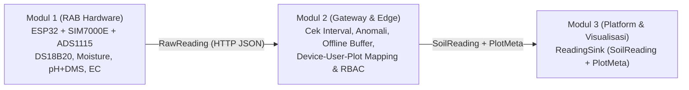

# Smart Soil IoT — Modul 2: IoT Communication, Edge Processing, and User Management

Proyek **Pemrograman Fungsional (Rust + Axum)** untuk sistem pemantauan tanah pertanian lahan gambut (*Peatland Agriculture*).

---

## 1. Arsitektur: Pemisahan *Pure Functions* vs *Side-Effect Shell*

Sesuai prinsip **Functional Programming**, kode di repositori ini dipisahkan secara tegas menjadi dua lapisan:

1. **Pure Core (100% Fungsi Murni, Immutable, Higher-Order Function, Rekursi, & Komposisi):**
   - [`src/contracts.rs`](src/contracts.rs) — Kontrak data integrasi antar-modul (`RawReading`, `SoilReading`, `PlotMeta`, `QualityFlag`, `ReadingSink`).
   - [`src/anomaly.rs`](src/anomaly.rs) — Validasi 4 sensor tanah gambut sesuai **RAB Modul 1** (`DFRobot Capacitive Moisture + ADS1115`, `DS18B20 Temperature Probe`, `Sensor pH Analog + DMS`, `DFRobot Gravity TDS/EC`), deteksi anomali edge dengan *Higher-Order Function* (`evaluate_with_rules`), alarm fisik `Buzzer 5V`, dan kontrol interval sampling (`check_interval`).
   - [`src/retry.rs`](src/retry.rs) — Kebijakan retry (`should_retry`), perhitungan jeda *exponential backoff* **rekursif murni** (`hitung_backoff_ms`), dan manajemen antrean **Offline Buffering** imutabel (`enqueue_offline`, `take_reconnect_batch`).
   - [`src/device/`](src/device/mod.rs), [`src/user/`](src/user/mod.rs), [`src/rbac/`](src/rbac/mod.rs) — Registrasi perangkat imutabel (`registrasi_murni`), pemetaan kepemilikan perangkat & petak lahan (`Kepemilikan` + `PlotMeta`), serta matriks otorisasi RBAC (`Admin`, `Operator`, `Viewer`).
   - [`src/pipeline.rs`](src/pipeline.rs) — Komposisi fungsi *end-to-end* (`process_sensor_event_pure` dan `flush_offline_buffer_pure` menggunakan `.fold()`).
2. **Side-Effect Shell & Visualisasi Web UI:**
   - [`src/main.rs`](src/main.rs) — Server HTTP **Axum**, middleware autentikasi `X-API-Key`, dan endpoint REST API.
   - [`src/ui.rs`](src/ui.rs) — **Dashboard Web UI Interaktif** (`http://localhost:3000`) untuk simulasi pengiriman sensor, *Offline Buffering & Upload-on-Reconnect*, *Device Provisioning*, pengujian RBAC, dan inspeksi JSON kontrak Modul 3.

---

## 2. Kontrak Integrasi Antar-Modul (Modul 1 -> Modul 2 -> Modul 3)



### Format Output ke Modul 3 (`SoilReading` & `PlotMeta`)
```json
{
  "soil_reading": {
    "device_id": "ESP32-GAMBUT-01",
    "plot_id": "PLOT-KALTENG-01",
    "ts": "2026-11-01T10:30:00Z",
    "moisture_pct": 68.5,
    "temperature_c": 28.4,
    "ph": 4.5,
    "ec_ms_cm": 1.2,
    "quality": "good"
  },
  "plot_meta": {
    "plot_id": "PLOT-KALTENG-01",
    "name": "Petak Nanas Gambut Blok A",
    "latitude": -2.2083,
    "longitude": 113.9167,
    "area_ha": 1.5,
    "plant": "nanas"
  }
}
```

---

## 3. Pembagian Tugas Tim (4 Anggota Modul 2)

| Anggota | Tanggung Jawab Utama | File Modul | Konsep Fungsional |
|---------|----------------------|------------|-------------------|
| **Anggota 1 (Module Lead)** | Arsitektur Pure vs Side-Effect, Server Axum, Kontrak Integrasi M1-M2-M3, & Web Dashboard UI | `src/contracts.rs`, `src/pipeline.rs`, `src/main.rs`, `src/ui.rs` | Komposisi pipeline (`fold`, `and_then`), pemisahan I/O dari Pure Core |
| **Anggota 2** | Edge Anomaly Detection (4 Sensor Tanah Gambut RAB M1), Buzzer Alarm, & Sampling Interval Control | `src/anomaly.rs` | *Pure Functions*, *Higher-Order Function* (`evaluate_with_rules`, `filter_map`), *Pattern Matching* |
| **Anggota 3** | Konektivitas IoT (SIM7000E), Auto-Retry Policy, & Offline Buffering (*Upload-on-Reconnect*) | `src/retry.rs` | **Rekursi Murni** (`hitung_backoff_ms`), *Immutable Vec Chaining* (`enqueue_offline`, `take_reconnect_batch`) |
| **Anggota 4** | Device Provisioning, Pemetaan Kepemilikan (`Device -> User -> PlotMeta`), Autentikasi API Key & RBAC | `src/device/`, `src/user/`, `src/rbac/` | *Immutable Struct Updates* (`registrasi_murni`, `tetapkan_lengkap_murni`), *Pure Pattern Matching* RBAC |

---

## 4. Cara Menjalankan Server & Pengujian

```bash
# 1. Jalankan seluruh Unit Test & Integration Test
cargo test

# 2. Jalankan Server Axum & buka Web Dashboard UI di http://localhost:3000
cargo run
```
